# Domínio da Frequência

# **Computação Visual Ciência da Computação** 

Prof. André Kishimoto 2026 

## **Referências** 

Este material foi baseado e adaptado a partir das seguintes referências: ▪ **Computação Gráfica: teoria e prática vol. 2** AZEVEDO, E.; CONCI, A.; LETA, F. Alta Books, 2022. 

▪ **Processamento digital de imagens, 3ª ed.** GONZALES, R. C.; WOODS, R. C. Pearson Prentice Hall, 2010. 

- **Introduction to Visual Computing: Core Concepts in Computer Vision, Graphics, and Image Processing** 

MAJUDER, A.; GOPI, M. CRC Press, 2018 

- **Fundamentos da Imagem Digital (slides de aula)** CRUVINEL, L., 2012. 

**Domínio da Frequência** 

## **Fourier** 

▪ Filtragem de imagens digitais no domínio da frequência é realizada com a **Transformada de Fourier** (FT = _Fourier Transform_ ). ▪ Jean-Baptiste Joseph Fourier em 1807 – **Série de Fourier** : 

_“Qualquer_ **_função periódica_** _pode ser expressa como a soma de senos e/ou cossenos de diferentes frequências, cada uma multiplicada por um coeficiente diferente.”_ 

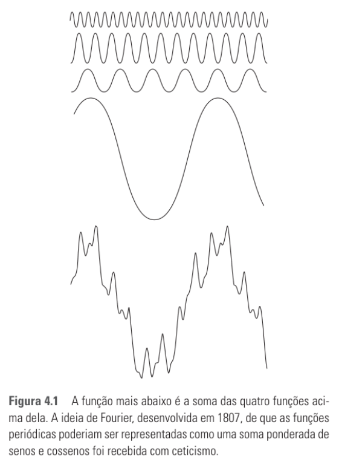

Fonte: **Processamento digital de imagens, 3ª ed.** (GONZALES, R. C.; WOODS, R. C., 2010) 

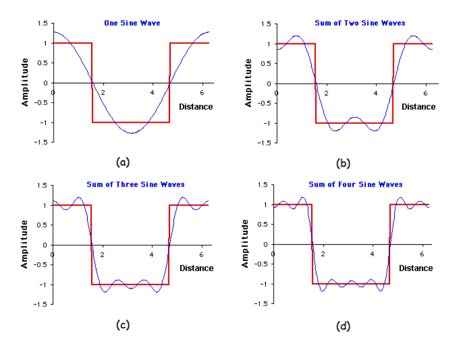

Fonte: **<u>https://en.wikibooks.org/wiki/Basic_Physics_of_Nuclear_Medicine/Fourier_Methods</u>** 

## **Característica** 

Uma função (série ou transformada) pode ser totalmente recuperada, sem perda de informação, por meio de um processo inverso. 

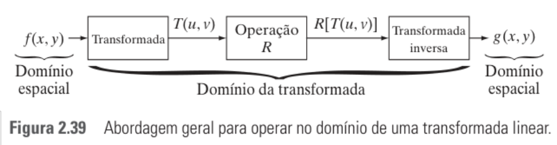

Fonte: **Processamento digital de imagens, 3ª ed.** (GONZALES, R. C.; WOODS, R. C., 2010) 

**FT de funções contínuas de uma variável** Seja 𝑓 𝑥 uma **função contínua** da variável real 𝑥, então sua 𝑥 **Transformada de Fourier** , expressa por ℑ 𝑓 , é definida pela equação: 

∞ ℑ 𝑓 𝑥 = ℱ 𝑓 𝑥𝑒−𝑗2𝜋𝑢𝑥 𝑑𝑥 𝑢= න −∞ 

Sendo: ▪ 𝑢: uma variável contínua ▪ 𝑗: −1 ▪ 𝑒: Número Euleriano 2,71828 … 

**IFT de funções contínuas de uma variável** Dada ℱ 𝑢 , a função 𝑓 𝑥 pode ser **recuperada** calculando-se a **Transformada de Fourier Inversa (IFT)** , 𝑓 𝑥= ℑ−1 ℱ 𝑢 , definida pela equação: 

∞ 

ℑ−1 ℱ 𝑢 = 𝑓 ℱ 𝑢𝑒𝑗2𝜋𝑢𝑥 𝑑𝑢 𝑥= න −∞ 

Sendo: ▪ 𝑢: uma variável contínua ▪ 𝑗: −1 ▪ 𝑒: Número Euleriano 2,71828 … 

**FT de funções contínuas de uma variável** Podemos considerar que a Transformada de Fourier de uma função real é um **valor complexo** , ou seja: 

ℱ 𝑢= 𝑅 𝑢 𝑢+ 𝑗𝐼 

Sendo: ▪ 𝑅 𝑢 : componente real do número complexo. ▪ 𝐼 𝑢 : componente imaginário do número complexo. 

## **Fourier** 

Para visualização, costuma-se trabalhar com a **magnitude** da Transformada de Fourier: 

ℱ 𝑢= ℱ 𝑢𝑒𝑗𝜙 𝑢 

Sendo: 

▪ ℱ 𝑢 : **Espectro de Fourier** ou **Espectro da Frequência** ▪ Indica o “quanto” de uma frequência está presente. 

▪ Mostra quais frequências estão presentes na função original e com quais amplitudes. ▪ 𝜙 𝑢 : Ângulo de fase 

▪ Indica “onde” a frequência está na imagem (mas nem sempre é usada, pois é mais fácil ver o conteúdo do domínio espacial). 

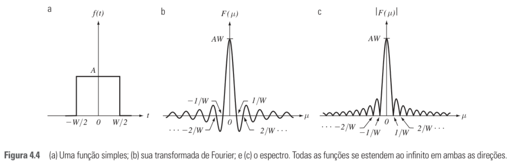

Fonte: **Processamento digital de imagens, 3ª ed.** (GONZALES, R. C.; WOODS, R. C., 2010) 

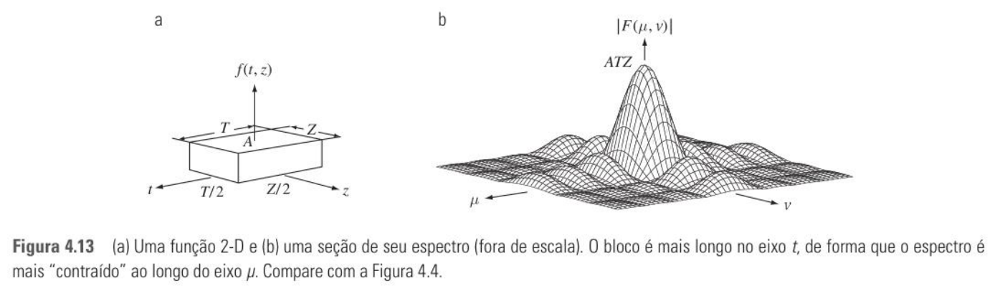

Fonte: **Processamento digital de imagens, 3ª ed.** (GONZALES, R. C.; WOODS, R. C., 2010) 

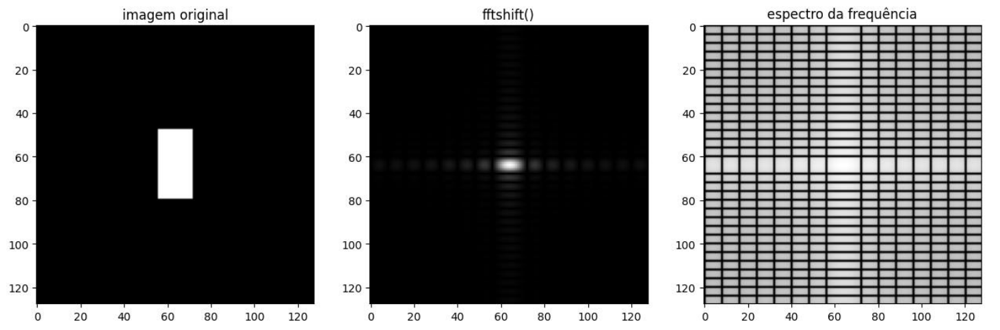

## **FT para imagem** 

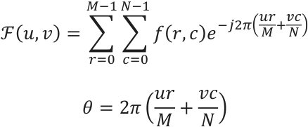

<!-- Start of picture text -->
𝑀−1 𝑁−1 𝑢𝑟 𝑣𝑐 ℱ 𝑓 𝑟, 𝑐𝑒 −𝑗2𝜋 𝑀 + 𝑁 𝑢, 𝑣= ෍ ෍ 𝑟=0 𝑐=0 𝑢𝑟 𝑣𝑐 𝜃= 2𝜋 𝑀 + 𝑁 <!-- End of picture text -->

𝑒−𝑗𝜃 = cos 𝜃−𝑗sin 𝜃 

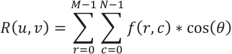

<!-- Start of picture text -->
𝑀−1 𝑁−1 𝑅 𝑓 𝑟, 𝑐∗cos 𝜃 𝑢, 𝑣= ෍ ෍ 𝑟=0 𝑐=0 <!-- End of picture text -->

#### Sendo: 

- 𝑀: número de linhas (altura da imagem). 

- ▪ 𝑁: número de colunas (largura da imagem). 

- 𝑓 𝑟, 𝑐 : valor do pixel na posição 𝑟, 𝑐 . 

- ℱ 𝑢, 𝑣 : valor da FT na posição 𝑢, 𝑣 . 

- 𝑅 𝑢, 𝑣 : componente real do número complexo. 

- 𝐼 𝑢, 𝑣 : componente imaginário do número complexo. 

𝑀−1 𝑁−1 𝐼 𝑓 𝑟, 𝑐∗sin 𝜃 𝑢, 𝑣= −෍ ෍ 𝑟=0 𝑐=0 

## **FT para imagem** 

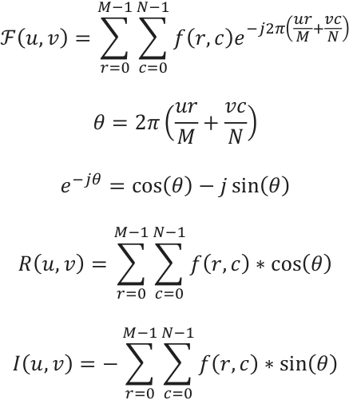

<!-- Start of picture text -->
𝑀−1 𝑁−1 𝑢𝑟 𝑣𝑐 ℱ 𝑓 𝑟, 𝑐𝑒 −𝑗2𝜋 𝑀 + 𝑁 𝑢, 𝑣= ෍ ෍ 𝑟=0 𝑐=0 𝑢𝑟 𝑣𝑐 𝜃= 2𝜋 𝑀 + 𝑁 𝑒 −𝑗𝜃 = cos 𝜃−𝑗sin 𝜃 𝑀−1 𝑁−1 𝑅 𝑓 𝑟, 𝑐∗cos 𝜃 𝑢, 𝑣= ෍ ෍ 𝑟=0 𝑐=0 𝑀−1 𝑁−1 𝐼 𝑓 𝑟, 𝑐∗sin 𝜃 𝑢, 𝑣= −෍ ෍ 𝑟=0 𝑐=0 <!-- End of picture text -->

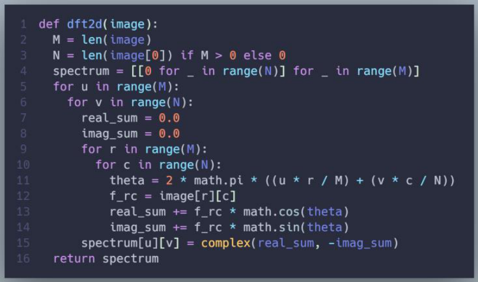

## **IFT para imagem** 

<!-- Start of picture text -->
𝑀−1 𝑁−1 𝑢𝑟 𝑣𝑐 1 ℱ 𝑀 + 𝑁 𝑓 𝑟, 𝑐= 𝑢, 𝑣𝑒 𝑗2𝜋 𝑀𝑁 ෍ ෍ 𝑢=0 𝑣=0 <!-- End of picture text -->

Sendo: 

- 𝑀: número de linhas (altura da imagem). 

- ▪ 𝑁: número de colunas (largura da imagem). 

- ℱ 𝑢, 𝑣 : valor da FT na posição 𝑢, 𝑣 . 

- 𝑓 𝑟, 𝑐 : valor da posição 𝑟, 𝑐 da imagem original recuperada. 

## **IFT para imagem** 

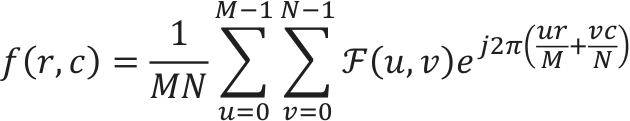

<!-- Start of picture text -->
𝑀−1 𝑁−1 𝑢𝑟 𝑣𝑐 1 ℱ 𝑀 + 𝑁 𝑓 𝑟, 𝑐= 𝑢, 𝑣𝑒 𝑗2𝜋 𝑀𝑁 ෍ ෍ 𝑢=0 𝑣=0 <!-- End of picture text -->

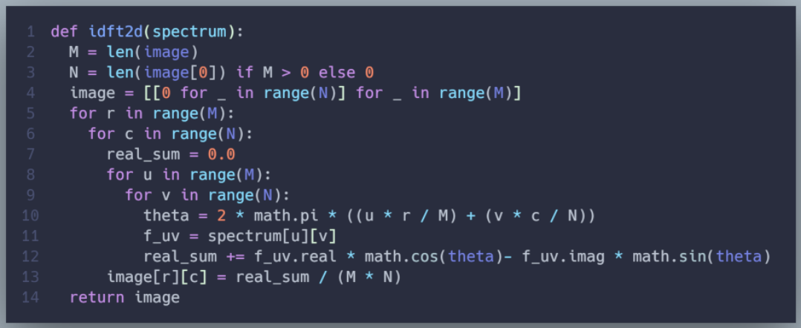

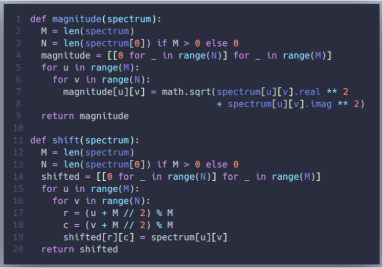

**FT para imagem** 

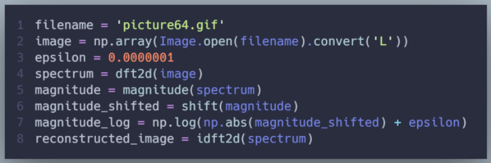

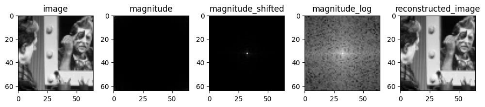

**FT para imagem** 

## **Dualidade** 

### Domínio Espacial 

X[t] 

Domínio da Frequência X[f] 

Impulso no domínio espacial (variação abrupta e localizada) é uma constante no domínio da frequência (impulso contém todas as frequências). 

t 

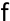

<!-- Start of picture text -->
f <!-- End of picture text -->

X[t] Constante no domínio espacial (sem variações) é um impulso no domínio da frequência (apenas a frequência zero está presente). 

<!-- Start of picture text -->
X[f] <!-- End of picture text -->

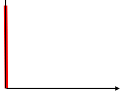

f 

t 

## **Dualidade** 

### Domínio Espacial 

X[t] 

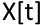

<!-- Start of picture text -->
X[t] <!-- End of picture text -->

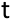

<!-- Start of picture text -->
t <!-- End of picture text -->

Alargamento em um domínio significa estreitamento no outro e vice-versa. 

### Domínio da Frequência 

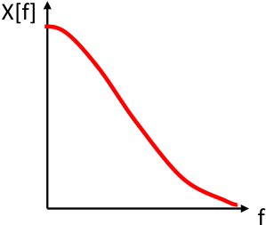

<!-- Start of picture text -->
X[f] f <!-- End of picture text -->

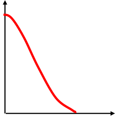

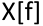

<!-- Start of picture text -->
X[f] <!-- End of picture text -->

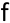

<!-- Start of picture text -->
f <!-- End of picture text -->

t 

## **Dualidade** 

Alargamento em um domínio significa estreitamento no outro e viceversa. 

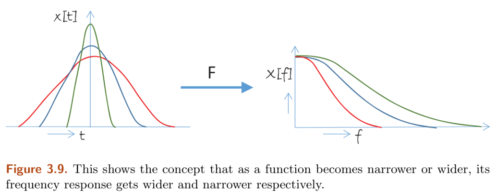

Fonte: **Introduction to Visual Computing** (MAJUDER, A.; GOPI, M., 2018) 

## **Dualidade** 

Convolução de duas funções no domínio espacial/temporal é uma multiplicação no domínio da frequência (e vice-versa). 

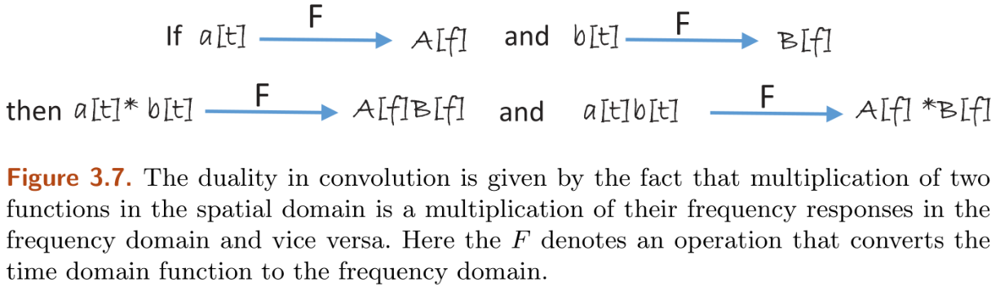

Fonte: **Introduction to Visual Computing** (MAJUDER, A.; GOPI, M., 2018) 

## **Convolução** 

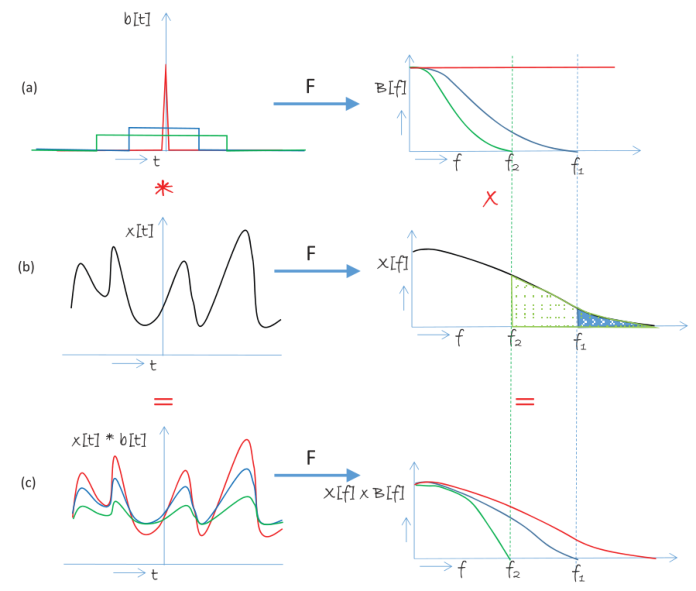

- (a) Filtros passa-baixa ( _low pass_ ) _b[t]_ (esq.) e respectivas frequências (dir.), com frequências de corte. 

- (b) Função geral _x[t]_ . 

(c) Convolução entre _x_ e _b_ no domínio espacial (esq.) implica em multiplicação entre _X[f]_ e _B[f]_ no domínio da frequência (dir.) 

Fonte: **Introduction to Visual Computing** (MAJUDER, A.; GOPI, M., 2018) 

## **Filtro passa-tudo (all pass)** 

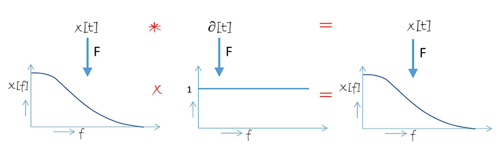

Fonte: **Introduction to Visual Computing** (MAJUDER, A.; GOPI, M., 2018) 

## **Filtro passa-baixa** 

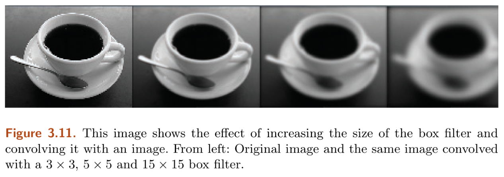

Fonte: **Introduction to Visual Computing** (MAJUDER, A.; GOPI, M., 2018) 

## **Filtro passa-baixa (espectro)** 

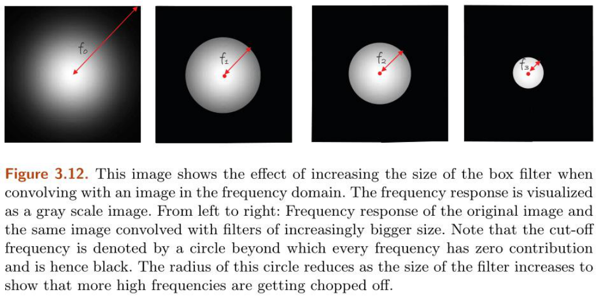

Fonte: **Introduction to Visual Computing** (MAJUDER, A.; GOPI, M., 2018) 

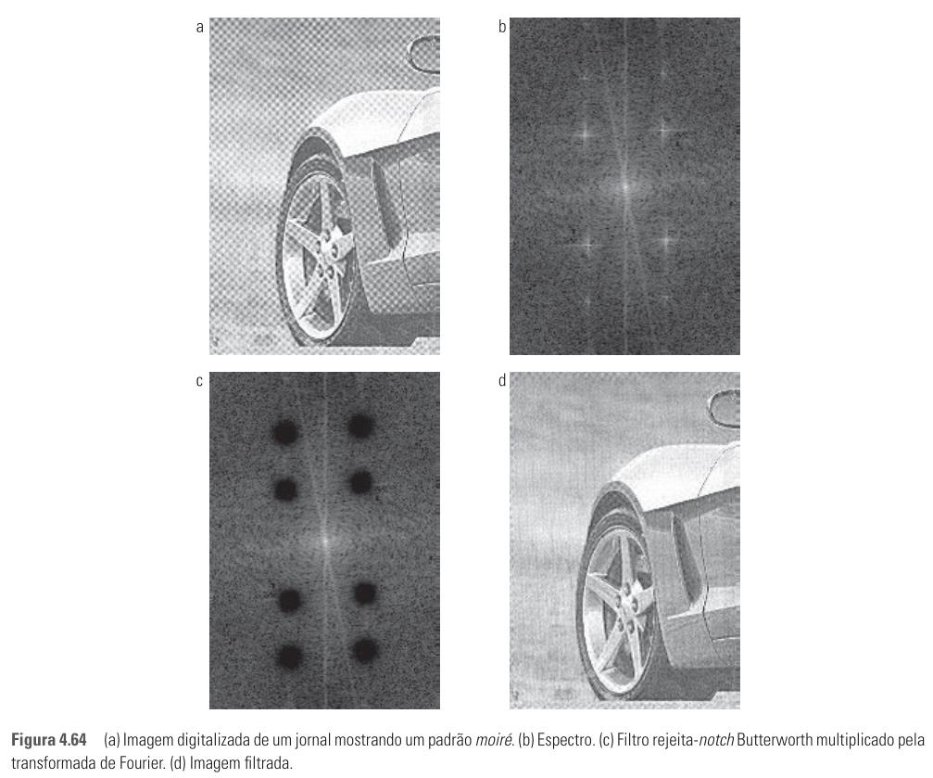

Fonte: **Processamento digital de imagens, 3ª ed.** (GONZALES, R. C.; WOODS, R. C., 2010) 

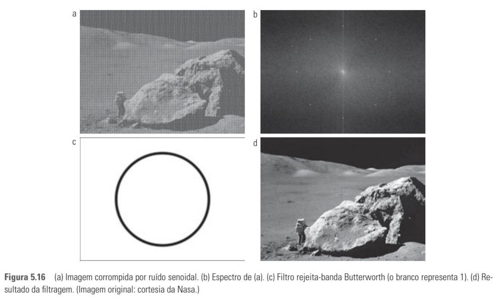

Fonte: **Processamento digital de imagens, 3ª ed.** (GONZALES, R. C.; WOODS, R. C., 2010) 

## **Funções amostradas** 

**Amostragem de Funções Contínuas** ▪ **Funções contínuas** são **convertidas** em uma sequência de **valores discretos** para serem processadas por um programa computacional. 

▪ Esse processo é realizado utilizando: 

▪ **Amostragem:** amostra da função contínua em intervalos uniformes de ∆𝑇. ▪ **Quantização:** valor do impulso de cada amostra da função contínua. 

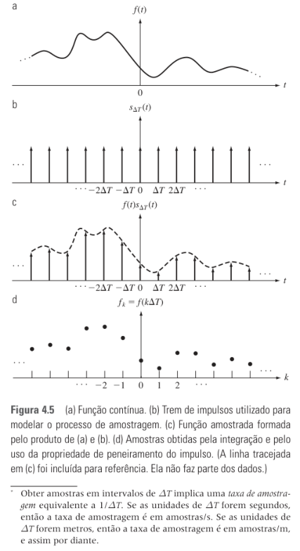

Fonte: **Processamento digital de imagens, 3ª ed.** (GONZALES, R. C.; WOODS, R. C., 2010) 

## **Funções amostradas** 

### **Transformada de Fourier de funções amostradas** 

▪ O intervalo entre as cópias da amostragem é determinado por: (∆𝑇 = taxa de amostragem). 

1 ∆𝑇 

▪ A taxa de amostragem pode gerar três situações: ▪ **Sobreamostragem:** separação entre os períodos (∆𝑇 pequeno). 

- **Amostragem crítica:** períodos vizinhos (frequência de Nyquist). 

- **Subamostragem:** os períodos foram sobrepostos, onde não foi possível preservar a transformada original (∆𝑇 grande). 

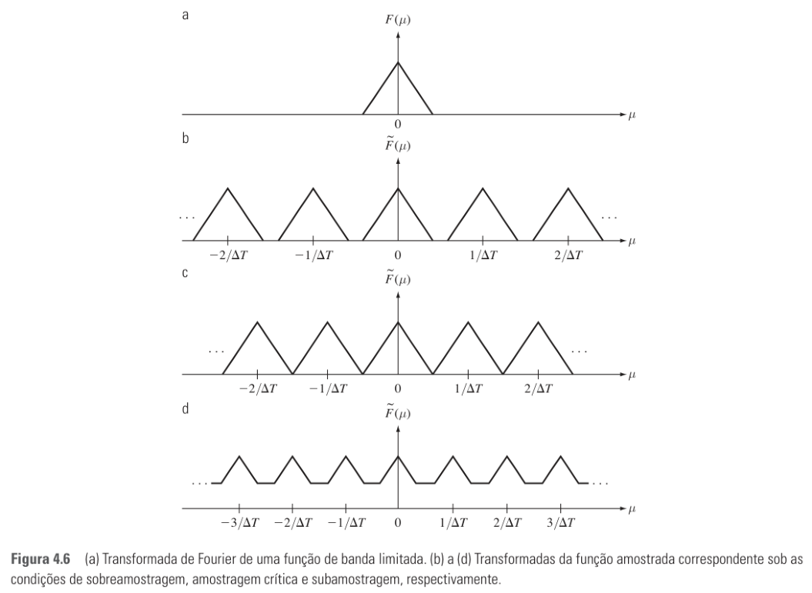

Fonte: **Processamento digital de imagens, 3ª ed.** (GONZALES, R. C.; WOODS, R. C., 2010) 

## **Funções amostradas** 

- **Teorema da amostragem** ▪ Uma função contínua pode ser **unicamente recuperada** (sinal original reconstruído) a partir do conjunto de suas amostras. 

- ▪ Uma **função de banda limitada** é uma função cuja Transformada de Fourier é zero para valores de frequências fora de um intervalo finito. 

   - Contém apenas frequências dentro de uma faixa finita, cujo intervalo é −𝜇𝑚𝑖𝑛, 𝜇𝑚𝑎𝑥 . 

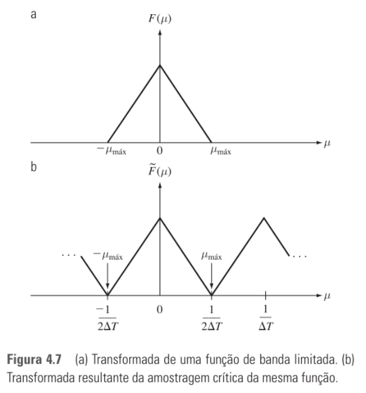

Fonte: **Processamento digital de imagens, 3ª ed.** (GONZALES, R. C.; WOODS, R. C., 2010) 

## **Funções amostradas** 

**Teorema da amostragem** ▪ A **separação suficiente** entre os períodos de uma função contínua é garantida se: 

1 1 2∆𝑇> 𝜇𝑚𝑎𝑥ou ∆𝑇> 2𝜇𝑚𝑎𝑥 

- As equações anteriores indicam que uma função de banda limitada contínua **pode ser recuperada** a partir de um conjunto de amostras **se** : 

   - **_As amostras_** _forem adquiridas em_ **_uma taxa maior_** _ao_ **_dobro da frequência mais alta_** _contida na função (taxa de Nyquist)._ 

## **Funções amostradas** 

### **_Aliasing_** 

▪ O _aliasing_ ocorre quando uma função de banda limitada é **amostrada** em uma **taxa menor** que o dobro de sua frequência mais alta. 

▪ Significa que o _aliasing_ é o exemplo de _subamostragem_ . ▪ No _aliasing_ , os períodos se sobrepõem e passa a ser impossível isolar um período da transformada. 

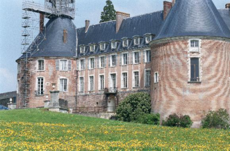

▪ Esse efeito também é conhecido como 

**_aliasing_ de frequência** . 

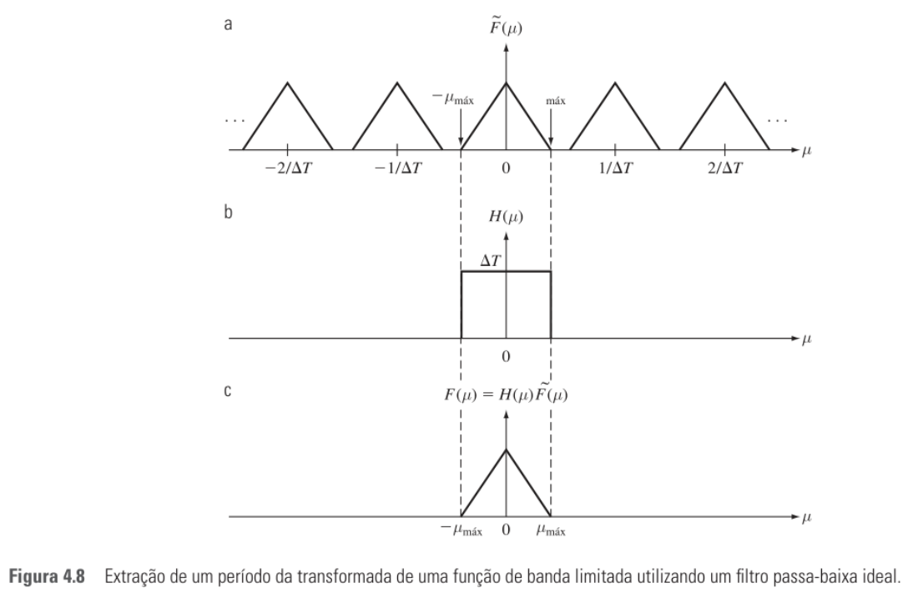

Fonte: **Processamento digital de imagens, 3ª ed.** (GONZALES, R. C.; WOODS, R. C., 2010) 

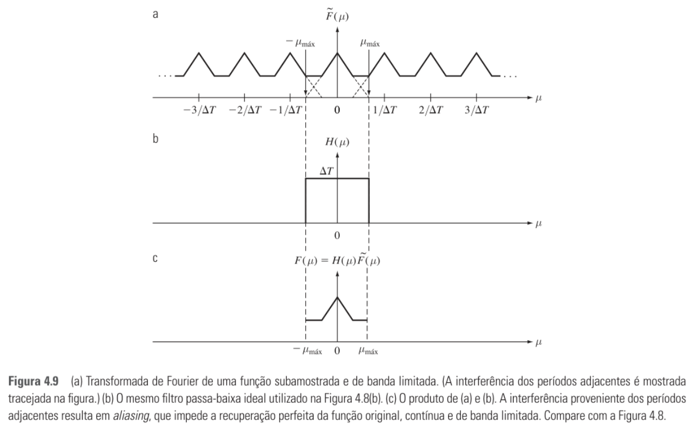

Fonte: **Processamento digital de imagens, 3ª ed.** (GONZALES, R. C.; WOODS, R. C., 2010) 

## **Funções amostradas** 

### **_Aliasing_** 

▪ Infelizmente, **o** **_aliasing_ é** um resultado **inevitável** ao trabalharmos com sinais **amostrados de tamanho finito** . 

- Os **efeitos** do _aliasing_ podem ser **reduzidos** pela **suavização** da função de entrada. 

   - Esse efeito é chamado de: **_antialiasing_** _._ 

   - **Por exemplo:** o borramento de imagens digitais que atenua as altas frequências (bordas e ruídos) da imagem de entrada. 

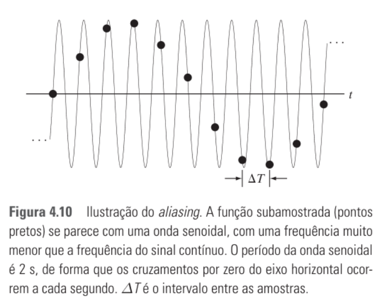

Fonte: **Processamento digital de imagens, 3ª ed.** (GONZALES, R. C.; WOODS, R. C., 2010) 

## **Funções amostradas** 

**_Aliasing_ em imagens digitais** 

▪ O ato de **limitar a duração** de uma função insere **componentes corruptores** na frequência. 

▪ Por esse motivo, o _aliasing_ está **sempre presente** em imagem digitais. 

▪ Da mesma forma como está presente nas funções 1D amostradas. ▪ O _aliasing_ se manifesta em imagens de duas formas: 

▪ _Aliasing_ temporal 

▪ _Aliasing_ espacial 

## **Funções amostradas** 

### **_Aliasing_ temporal** 

▪ Ocorre no **intervalo** existente entre imagens de uma sequência de imagens finitas. 

- O **exemplo** mais comum é o efeito de **"roda de carroça"** : ▪ Ocorre quando os raios das rodas em uma sequência de imagens (um vídeo) parecem estar girando para trás. 

▪ Esse efeito é provocado pelo fato de a velocidade de projeção ser baixa demais em relação à velocidade de rotação da roda na sequência. 

## **Funções amostradas** 

### **_Aliasing_ espacial** 

▪ Ocorre devido à **subamostragem** no domínio da imagem digital. ▪ Os **principais problemas** do _aliasing_ espacial são: 

- A inserção de artefatos com _jaggies_ (serrilhados) nas linhas de uma sequência de _pixels._ 

- Saliências falsas. 

- Aparecimento de padrões de frequência ausentes na imagem original. 

## **Funções amostradas** 

**Reduzindo o efeito do** **_aliasing_ em imagens** ▪ Para reduzir o efeito do _aliasing_ , devemos **atenuar** as **altas frequências** da imagem digital. 

   - Lembrando que, para atenuar as altas frequências, aplicamos um filtro passa-baixa (borramento). 

- Esse processo é conhecido como **_antialiasing_** _._ 

   - O _antialiasing_ é realizado antes da (re)amostragem da imagem. 

## **Funções amostradas** 

**_Aliasing_ em imagens reamostradas** ▪ A **reamostragem** de _pixels_ ocorre no processo de redimensionamento de imagens. 

▪ Observamos os seguintes comportamentos na reamostragem de imagens: 

▪ **Ampliação:** pode ser vista como uma sobreamostragem. ▪ **Redução:** pode ser vista como uma subamostragem. 

## **Funções amostradas** 

**_Aliasing_ em imagens reamostradas** ▪ Usando o modelo de vizinho mais próximo no processo de interpolação de pixels... 

   - Para diminuir a imagem em 50% 

      - Exclui-se linha sim e outra não; e 

      - Exclui-se coluna sim e outra não. 

   - Para aumentar a imagem em 50% 

      - Duplica-se cada linha da imagem; e 

      - Duplica-se cada coluna da imagem. 

- Veja o exemplo do efeito de _aliasing_ de frequência em uma imagem reamostrada no slide seguinte. 

Fonte: **Processamento digital de imagens, 3ª ed.** (GONZALES, R. C.; WOODS, R. C., 2010) 

## **Artefatos de aliasing** 

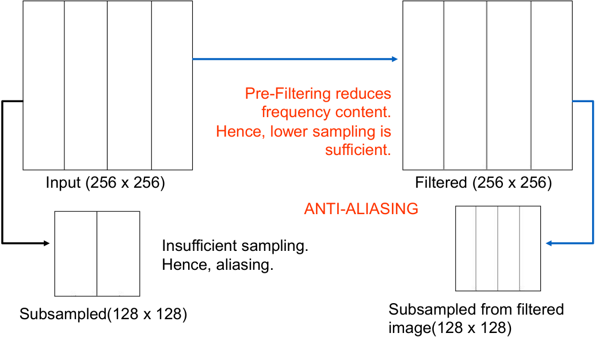

<!-- Start of picture text -->
Pre-Filtering reduces frequency content. Hence, lower sampling is sufficient. Input (256 x 256) Filtered (256 x 256) ANTI-ALIASING Insufficient sampling. Hence, aliasing. Subsampled from filtered Subsampled(128 x 128) image(128 x 128) <!-- End of picture text -->

Fonte: **Introduction to Visual Computing** (MAJUDER, A.; GOPI, M., 2018) 

